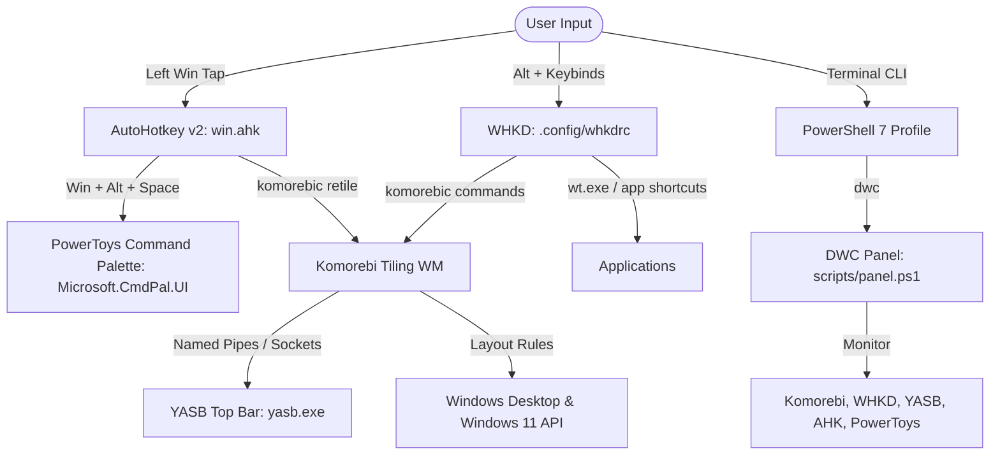

# System Architecture

This document describes the architectural layers, inter-process communication (IPC), and event flows that power **DWC Shell**.

---

## 1. Architectural Layers

### Layer 1: Window Management & Tiling (Komorebi + Applications)
* **Host Executable**: `komorebi.exe` (or `komorebic-no-console.exe`).
* **CLI Controller**: `komorebic.exe`.
* **Configuration**: `komorebi.json` defines workspaces (I through VII), 10px inner/outer padding, animations, and active border styling.
* **Application Quirks (`applications.json`)**: Handles special applications that bypass standard Win32 window messaging. For instance, FL Studio performs custom non-standard drags without triggering `EVENT_SYSTEM_MOVESIZEEND`; AutoHotkey collaborates with Komorebi to retile on mouse release.

### Layer 2: Global Hotkey Daemon (WHKD)
* **Executable**: `whkd.exe`.
* **Configuration**: `.config/whkdrc`.
* **Role**: Intercepts `Alt`-based keyboard combinations and translates them directly into `komorebic` IPC commands (e.g., `Alt + h/j/k/l` for directional focus, `Alt + Shift + h/j/k/l` for movement, `Alt + 1-8` for workspace switching).
* **Reloading**: Can be reloaded on the fly with `Alt + o` without dropping window focus.

### Layer 3: Application Launcher (PowerToys CmdPal)
* **Host Engine**: `PowerToys.exe` (v0.102.3001.0, held via Scoop).
* **Palette Process**: `Microsoft.CmdPal.UI.exe`.
* **Configuration**: `%LOCALAPPDATA%\Microsoft\PowerToys\settings.json`.
* **Constraint**: All background modules (Awake, FancyZones, Mouse Jump, etc.) are explicitly disabled in `settings.json`. ONLY `CmdPal` is enabled to keep memory and CPU usage near zero when idle.
* **Activation**: Listens natively for `Win + Alt + Space` (`#!{Space}`).

### Layer 4: Input Interception & Quirks (AutoHotkey v2)
* **Script**: `win.ahk`.
* **Process**: `AutoHotkey64.exe`.
* **Windows Key Interception**: Tapping the Left Windows key without modifier combinations normally triggers the Windows Start menu. `win.ahk` sends `{Blind}{vkE8}` on press to mask the key from the Windows shell, waits for key release, and if no other key was pressed, sends `#!{Space}` to invoke Command Palette.
* **Mouse Retiling**: Tracks mouse down/up on specific window classes (such as `TFruityLoopsMainForm`) and executes `komorebic retile` hidden in the background upon release if window geometry changed.

### Layer 5: Top Status Bar (YASB)
* **Executable**: `yasb.exe`.
* **Configuration**: `.config/yasb/config.yaml`.
* **Styling**: `.config/yasb/styles.css` imports the active `.config/yasb/theme.css`.
* **Themes**: Stored under `.config/yasb/themes/` (`glass.css`, `amoled.css`, `opaque.css`). Switchable at runtime via `scripts/panel.ps1` or `.config/yasb/set-theme.ps1`.
* **Widgets**: Displays Komorebi active workspace, system clock, network ping status (`connection.cmd`), volume, battery, and quick theme toggle.

### Layer 6: User Shell & Control Plane (`dwc`)
* **Shell**: PowerShell 7 (`pwsh.exe`) linked to `$PROFILE`.
* **Prompt**: Starship (`.config/starship.toml`) + Fastfetch (`.config/fastfetch/config.jsonc`).
* **Command**: `dwc` defined in `powershell/profile.ps1`. Running `dwc` opens `scripts/panel.ps1`; running `dwc git <args>` invokes Git on the bare repo.

---

## 2. Startup & Execution Flow

When Windows starts up or `setup.ps1` runs:

1. **Shortcuts (`shell:startup`)**:
   - `win-hotkeys.lnk` starts `AutoHotkey64.exe win.ahk`.
   - `komorebi.lnk` starts `komorebic-no-console start --whkd` (which starts both Komorebi and WHKD together).
   - `yasb.lnk` starts `yasb.exe`.
2. **Task Scheduler (PowerToys)**:
   - PowerToys does not use a shortcut in `shell:startup`. When `"startup": true` is set in `%LOCALAPPDATA%\Microsoft\PowerToys\settings.json`, PowerToys registers its own non-elevated background startup task via Windows Task Scheduler.
3. **Execution Safety**:
   - `scripts/start.ps1` checks `Get-Process` before launching any daemon. It never creates duplicate running instances.
